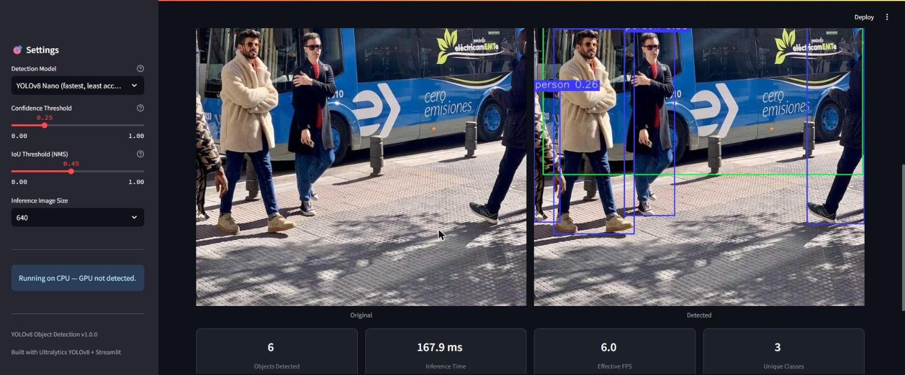
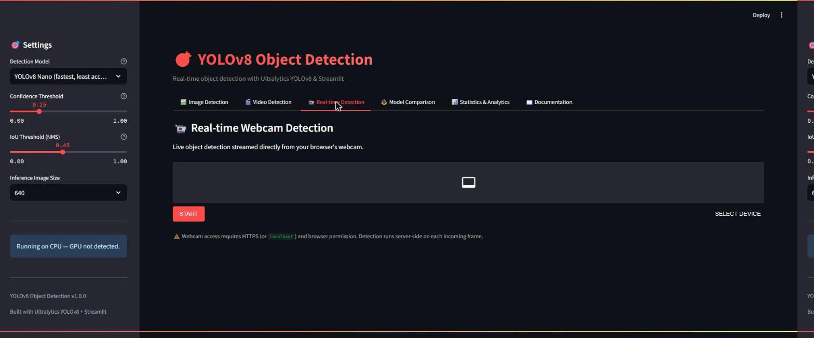
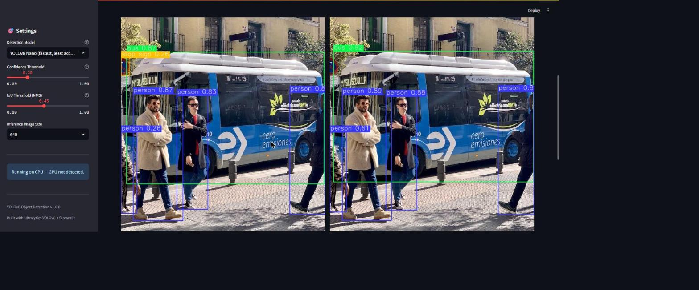
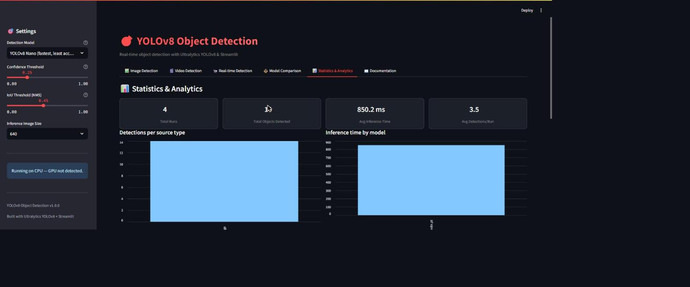

# 🎯 YOLOv8 Object Detection Web Application

<p align="center">
  
  
  
  
  
  
  
</p>

<p align="center">
  A production-style, full-stack computer vision application built on
  <a href="https://github.com/ultralytics/ultralytics">Ultralytics YOLOv8</a> and
  <a href="https://streamlit.io">Streamlit</a> — real-time object detection
  for images, video, and live webcam, with model comparison, object
  tracking, a REST API, and a built-in analytics dashboard.
</p>

---

## ✨ Features

| Category | Details |
|---|---|
| 🖼️ **Image Detection** | Upload single or multiple images, adjustable confidence/IoU thresholds, downloadable annotated output |
| 🎬 **Video Detection** | Frame-by-frame inference on uploaded video, optional **ByteTrack** object tracking, annotated `.mp4` export |
| 📹 **Real-time Detection** | Live, in-browser webcam inference via `streamlit-webrtc` (works locally and over HTTPS deployments) |
| ⚖️ **Model Comparison** | Run nano/small/medium/large/x-large side-by-side on the same image with a benchmark summary table |
| 📊 **Statistics & Analytics** | Persistent detection history, per-model timing, per-class distribution charts |
| ⚙️ **Model Caching** | Weights load once per process (`st.cache_resource`) — instant tab switching |
| 🚀 **GPU Acceleration** | Auto-detects CUDA (falls back to Apple MPS, then CPU) — no config needed |
| 🧪 **Tested** | `pytest` suite for the detection engine and utilities, offline by default |
| 🐳 **Dockerized** | One-command deployment, with a documented GPU-passthrough path |
| 🔌 **REST API** | Optional FastAPI service (`/predict`, `/health`, `/models`) for headless integration |

## 📸 Demo & Screenshots

### Image Detection
Upload an image (or use a bundled sample) and get an annotated result
side-by-side with the original, plus per-run stats (objects detected,
inference time, effective FPS, unique classes).



### Real-time Webcam Detection
Live, in-browser webcam inference via `streamlit-webrtc` — detection runs
server-side on each incoming frame. (Shown here is the tab's entry screen;
the live feed requires a webcam-enabled browser session.)



### Model Comparison
Run two or more YOLOv8 variants (Nano, Small, Medium, ...) on the same
image side-by-side, with a summary table of detections, inference time,
parameter count, and published COCO mAP50-95.



### Statistics & Analytics Dashboard
Persistent detection history across the session — total runs, total
objects detected, average inference time, detections per source type, and
inference time per model.



## 🏗️ Architecture

```
Browser (Streamlit UI)
        │
        ▼
 src/app.py  ──────────────►  src/detector.py  ──────────────►  Ultralytics YOLOv8
   (6 tabs, session state)      (ModelCache, InferenceConfig)      (PyTorch, CUDA/CPU)
        │                              │
        ▼                              ▼
 src/utils.py (drawing, I/O)   outputs/detection_history.csv
        │
        ▼
 src/api.py  ──► FastAPI REST endpoint (optional, headless clients)
```

## 📁 Project Structure

```
yolov8-object-detection-app/
├── src/
│   ├── app.py            # Streamlit application (6 tabs)
│   ├── detector.py        # YOLOv8 inference engine (caching, tracking, batching)
│   ├── utils.py            # Drawing, I/O, logging, analytics helpers
│   ├── config.py           # Centralized configuration & constants
│   └── api.py               # Optional FastAPI REST endpoint
├── notebooks/
│   └── tutorial.ipynb      # Programmatic usage + custom training walkthrough
├── assets/
│   ├── sample_images/       # bus.jpg, zidane.jpg (bundled test images)
│   └── sample_video/
├── docs/
│   ├── INSTALLATION.md
│   ├── USAGE.md
│   ├── DEPLOYMENT.md
│   └── API.md
├── tests/
│   ├── test_detector.py
│   └── test_utils.py
├── Dockerfile
├── docker-compose.yml
├── requirements.txt
├── pytest.ini
├── CONTRIBUTING.md
├── CHANGELOG.md
├── LICENSE
└── README.md
```

## 🚀 Quick Start

```bash
git clone https://github.com/yazenemino/yolov8-object-detection-app.git
cd yolov8-object-detection-app
python -m venv .venv && source .venv/bin/activate   # Windows: .venv\Scripts\activate
pip install -r requirements.txt
streamlit run src/app.py
```

Open **http://localhost:8501** — the app loads the YOLOv8-Nano model by
default (auto-downloaded on first run) and is ready to use immediately with
the bundled sample images.

Full setup details (GPU/CUDA, troubleshooting): **[docs/INSTALLATION.md](docs/INSTALLATION.md)**.

### Docker

```bash
docker compose up --build
```

See **[docs/DEPLOYMENT.md](docs/DEPLOYMENT.md)** for Docker GPU support and
cloud deployment (Streamlit Community Cloud, Railway, Render, Hugging Face
Spaces).

## 📊 Model Options & Benchmarks

Published Ultralytics COCO val benchmarks (mAP50-95, single V100 GPU) —
actual throughput on your hardware is measured live in the **Model
Comparison** tab:

| Model | Params (M) | mAP50-95 | CPU speed (ms) | GPU speed (ms) | Best for |
|---|---|---|---|---|---|
| YOLOv8n | 3.2 | 37.3 | 80.4 | 1.47 | Real-time, edge devices |
| YOLOv8s | 11.2 | 44.9 | 128.4 | 2.66 | Balanced default |
| YOLOv8m | 25.9 | 50.2 | 234.7 | 5.86 | Higher accuracy |
| YOLOv8l | 43.7 | 52.9 | 375.2 | 9.06 | Accuracy-critical |
| YOLOv8x | 68.2 | 53.9 | 479.1 | 14.37 | Maximum accuracy |

## 🧪 Testing

```bash
pytest -m "not integration"   # fast, fully offline (no model download)
pytest                        # full suite, downloads yolov8n.pt on first run
pytest --cov=src              # with coverage report
```

## 🔌 REST API (optional)

```bash
uvicorn src.api:app --reload --port 8000
# then open http://localhost:8000/docs for interactive Swagger UI
```

See **[docs/API.md](docs/API.md)** for the full endpoint reference and
`curl`/Python examples.

## 🛠️ Troubleshooting

| Problem | Solution |
|---|---|
| `RuntimeError: Could not load model` | Check internet access — weights auto-download on first use from Ultralytics. |
| Webcam tab shows an install warning | `pip install streamlit-webrtc av` |
| CUDA not detected despite having a GPU | Reinstall PyTorch from the CUDA-matched index — see `docs/INSTALLATION.md`. |
| Slow inference on CPU | Use YOLOv8-Nano/Small and/or reduce the inference image size in the sidebar. |
| `ffmpeg`/video codec errors in Docker | Rebuild — the image installs `ffmpeg` and `libgl1` for OpenCV/video support. |

More in **[docs/USAGE.md](docs/USAGE.md)**.

## 🗺️ Future Improvements

- [ ] Custom dataset upload + fine-tuning UI (tutorial notebook already covers the CLI/SDK flow)
- [ ] Multi-camera / RTSP stream support
- [ ] Export predictions to COCO/YOLO annotation formats
- [ ] Authentication layer for multi-user deployments
- [ ] Async batch job queue for large video files
- [ ] ONNX / TensorRT export for optimized edge inference

## 🤝 Contributing

Contributions are welcome — see **[CONTRIBUTING.md](CONTRIBUTING.md)**.

## 📄 License

This project's code is licensed under the **MIT License** — see
**[LICENSE](LICENSE)**. It depends on Ultralytics YOLOv8 (AGPL-3.0); see
**[NOTICE.md](NOTICE.md)** for what that means if you deploy this
commercially.

## 🙏 Credits

- **[Ultralytics YOLOv8](https://github.com/ultralytics/ultralytics)** — the detection models and inference engine this project wraps.
- **[Streamlit](https://streamlit.io)** — the web application framework.
- **[streamlit-webrtc](https://github.com/whitphx/streamlit-webrtc)** — browser webcam streaming.
- Sample images (`bus.jpg`, `zidane.jpg`) are the standard Ultralytics test assets.

## 👤 Author

**Yazen Emino**
Built as a portfolio project demonstrating end-to-end applied computer
vision engineering: model integration, production app architecture,
testing, containerization, and documentation.
